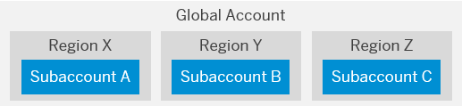
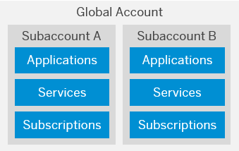
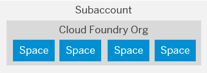
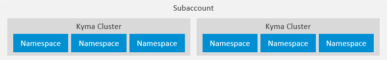
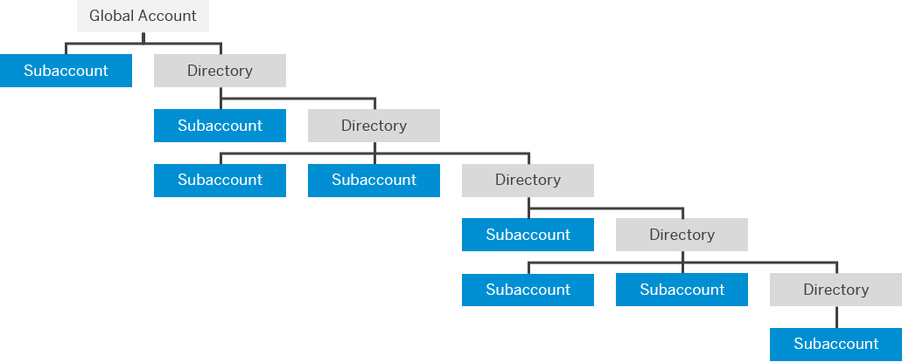

<!-- loio730bdd6a9a6b46c4ae3c5bce3bea8e5c -->

# Account Model

The SAP BTP cockpit is structured according to global accounts and subaccounts. You can also use directories and labels to organize your account model.

<a name="loio730bdd6a9a6b46c4ae3c5bce3bea8e5c__section_z22_xcr_32b"/>

## Global Accounts

A **global account** is the realization of a contract you or your company has made with SAP.

A global account is used to manage subaccounts, members, entitlements and quotas. You receive entitlements and quotas to use platform resources per global account and then distribute the entitlements and quotas to the subaccount for actual consumption. There are two types of commercial models for global accounts: consumption-based model and subscription-based model. See [Commercial Models](commercial-models-263d400.md) .

Global accounts are region- and environment-independent. Within a global account, you manage all of your subaccounts, which in turn are specific to one region.

<a name="loio730bdd6a9a6b46c4ae3c5bce3bea8e5c__section_cmv_ycr_32b"/>

## Subaccounts

In **subaccounts**, you deploy applications, use services, and manage your subscriptions. You can use them to manage members, authorizations, and entitlements.

A global account can contain one or more subaccounts in which you deploy applications, use services, and manage your subscriptions. Subaccounts in a global account are independent from each other. This is important to consider with respect to security, member management, data management, data migration, integration, and so on, when you plan your landscape and overall architecture.

Each subaccount is associated with a region, which is the physical location where applications, data, or services are hosted. The specific region is relevant when you deploy applications and access the SAP BTP cockpit using the corresponding cockpit URL. The region assigned to your subaccount doesn't have to be directly related to your location. You could be located in the United States, for example, but operate your subaccount in Europe.

The entitlements and quotas that have been purchased for a global account have to be assigned to the individual subaccounts.

Global accounts and subaccounts are completely independent of user accounts. For more information, see [User and Member Management](https://help.sap.com/viewer/65de2977205c403bbc107264b8eccf4b/Cloud/en-US/cc1c676b43904066abb2a4838cbd0c37.html "On SAP BTP, user management takes place at all levels from global account to environment. There are different types of users, such as depending on their roles in the company.") :arrow_upper_right:.

**Subaccounts, Cloud Foundry Orgs and Kyma Clusters**

-   When you enable the Cloud Foundry environment in one of your subaccounts, the system automatically creates a Cloud Foundry org for you. The subaccount and the org have a 1:1 relationship and the same navigation level in the cockpit \(even though they may have different names\). You can create spaces within that Cloud Foundry org. Spaces let you further break down your account model and use services and functions in the Cloud Foundry environment.

    

    For more information about Cloud Foundry orgs and spaces, see the Cloud Foundry documentation at [https://docs.cloudfoundry.org/concepts/roles.html](https://docs.cloudfoundry.org/concepts/roles.html).

-   When you enable the Kyma environment in one of your subaccounts, you can provision one or more Kubernetes clusters equipped with the latest version of the open-source project "Kyma". The subaccount and the Kyma cluster have a 1:n relationship - you can choose to create more than one cluster right away, or add clusters later.

    Within each Kyma cluster, you can create namespaces to organize your workloads and control access to resources. Namespaces let you further break down your account model and use services and functions in the Kyma environment. For more information, see the Kubernetes documentation at [https://kubernetes.io/docs/concepts/overview/working-with-objects/namespaces/](https://kubernetes.io/docs/concepts/overview/working-with-objects/namespaces/).

    

<a name="loio730bdd6a9a6b46c4ae3c5bce3bea8e5c__section_m4y_bh4_2nb"/>

## Directories

With **directories**, you can organize and manage your subaccounts according to your technical and business needs.

A directory can contain directories and subaccounts to create a hierarchy. Using directories to group other directories and subaccounts is optional - you can still create subaccounts directly under your global account.

You can create a hierarchical structure that is up to 7 levels deep. The highest level of a given path is always the global account and the lowest is a subaccount, which means that you can have up to 5 levels of directories between the global account and the lowest level subaccount.

Directories enable you to:

-   Group and filter directories and subaccounts

-   Monitor usage and costs for contracts that use the consumption-based commercial model

Optionally, you can also enable the following features in your directories:

-   Manage Entitlements: Enables the assignment of a quota for services and applications to the directory from the global account quota, for distribution to the directory's subaccounts.

    When you assign entitlements to a directory, you express the entitlements and maximum quota that can be distributed across its children subaccounts. You also have the option to choose the auto-assignment of a set amount of quota to all subaccounts created or moved to that directory. Subaccounts that are already in the directory when you select that option will not be auto-assigned quota.

    > ### Note:  
    > If you've enabled the Manage Entitlements feature for a given directory, you must first assign the necessary entitlements and maximum allowed quota from the global account to that directory. Then you can distribute this "reserved" quota to any of the directory's child subaccounts.

-   Manage Authorizations: Enables authorization management for the directory. For example, it allows certain users to manage directory entitlements. You can only use this feature in combination with the *Manage Entitlements* feature.

<a name="loio730bdd6a9a6b46c4ae3c5bce3bea8e5c__section_kv3_whb_gnb"/>

## Labels

Labels are user-defined words or phrases that you can assign to various entities in SAP BTP to categorize them in your global account, to identify them more easily. They let you organize and filter your directories, subaccounts, instances and subscriptions within your global account.

For more information, see [Labels](https://help.sap.com/viewer/65de2977205c403bbc107264b8eccf4b/Cloud/en-US/8ed4a705efa0431b910056c0acdbf377.html#loioe8663c08ead648faa673b0d63c5b478e "Labels are user-defined words or phrases that you can assign to various entities in SAP BTP to categorize them in your global account, to identify them more easily.") :arrow_upper_right:.

**Related Information**  

[Account Model](https://help.sap.com/viewer/65de2977205c403bbc107264b8eccf4b/Cloud/en-US/8ed4a705efa0431b910056c0acdbf377.html#loio8ed4a705efa0431b910056c0acdbf377 "Learn more about the different types of accounts on SAP BTP and how they relate to each other.") :arrow_upper_right:

[Managing Global Accounts Using the Cockpit](https://help.sap.com/viewer/65de2977205c403bbc107264b8eccf4b/Cloud/en-US/667f34ba9222450491c2b848cd17e189.html "Your SAP BTP global account is the entry point for managing the resources, landscape, and entitlements for your departments and projects in a self-service manner.") :arrow_upper_right:

[Managing Directories Using the Cockpit](https://help.sap.com/viewer/65de2977205c403bbc107264b8eccf4b/Cloud/en-US/f495ac1a62684affbff9f2629fe58bb0.html "Learn how to organize and manage your subaccounts according to your technical and business needs by using directories in the SAP BTP cockpit.") :arrow_upper_right:

[Managing Subaccounts Using the Cockpit](https://help.sap.com/viewer/65de2977205c403bbc107264b8eccf4b/Cloud/en-US/55d0b6d8b96846b8ae93b85194df0944.html "Learn how to structure a global account according to your organization’s and project’s requirements with regard to members, authorizations, and entitlements by managing subaccounts.") :arrow_upper_right:

[Setting Up Your Account Model](../set-up-and-plan/setting-up-your-account-model-2db81f4.md "Your account model defines how you organize global accounts, directories, and subaccounts in SAP BTP to match your business and development needs.")

