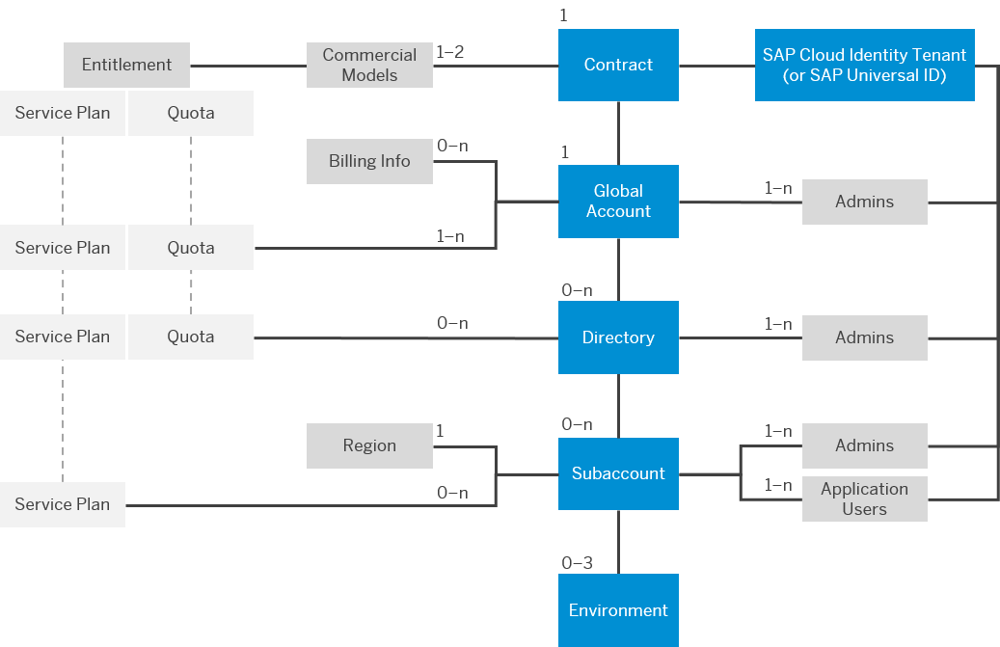

<!-- loio38ecf59cdda64150a102cfaa62d5faab -->

# Basic Platform Concepts

SAP BTP offers users the ability to turn data into business value, compose end-to-end business processes, and build and extend SAP applications quickly.

SAP Business Technology Platform is built on a multi-cloud foundation, which lets you choose from different infrastructures and runtimes. The services and solutions of SAP BTP are available on multiple cloud infrastructure providers, and it supports different runtimes, such as Cloud Foundry, ABAP, and Kyma, as well as multiple regions, and a broad choice of programming languages.

The central point of entry to the platform is the **SAP BTP cockpit**, where you can access your accounts and applications and manage all activities associated with them.

Check out the [SAP Discovery Center](https://discovery-center.cloud.sap/) to get an overview on the available SAP BTP **services**, discover **missions** that guide you step-by-step, and explore **reference architectures**.

<a name="loio38ecf59cdda64150a102cfaa62d5faab__section_ocw_nbx_ywb"/>

## Overview of Global Accounts, Directories, and Subaccounts

The following diagram depicts the relationship between a global account, its directories, subaccounts, runtime environments, regions, entitlements, and quotas.

<a name="loio38ecf59cdda64150a102cfaa62d5faab__section_ozn_1cx_ywb"/>

## Administrative Tasks

<table>
<tr>
<th valign="top">

Level

</th>
<th valign="top">

Administrative Tasks

</th>
</tr>
<tr>
<td valign="top">

Global Account

</td>
<td valign="top">

-   Global accounts are region- and runtime-independent.

-   Usually, for each commercial model \(licence type\), you get a separate global account. It is however possible to combine two commercial models in one global account. See [Commercial Models](https://help.sap.com/docs/btp/best-practices/basic-platform-concepts#commercial-models).

-   Appoint at least one person as administrator. The administrator is responsible for adding new subaccounts, adding members to a global account, and managing the entitlements.

-   You purchase entitlements for each global account \(according to your commercial model\). The administrator of the global account distributes quotas to the individual subaccounts.

</td>
</tr>
<tr>
<td valign="top">

Directory \(optional\)

</td>
<td valign="top">

-   Directories are groups of subaccounts that you can manage, operate, and analyze together.

-   Appoint at least one person as administrator. The administrator is responsible for adding new subaccounts, managing members, and managing entitlements.

</td>
</tr>
<tr>
<td valign="top">

Subaccount

</td>
<td valign="top">

-   Each subaccount runs in exactly one region. Within a subaccount, you can enable multiple, different runtime environments.

-   Appoint at least one person as administrator. The administrator is responsible for adding new members to the subaccount and assigning their business roles.

</td>
</tr>
</table>

> ### Recommendation:  
> For each administrator, we recommend that you also appoint at least one substitute administrator. If the main administrator leaves the company or is unavailable, it's important that you have someone who's available to take over these tasks.

For more information, see [Account Model](account-model-730bdd6.md) and [Setting Up Your Account Model](../set-up-and-plan/setting-up-your-account-model-2db81f4.md).

