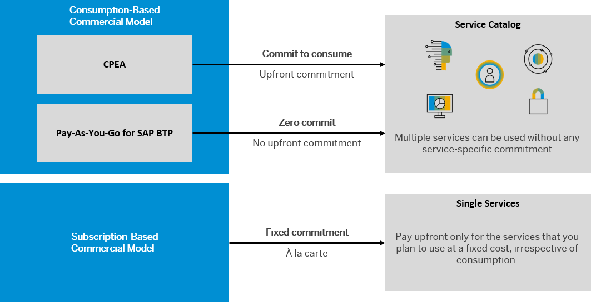

<!-- loio263d40009a5a4237a62e8f5c05ee641e -->

# Commercial Models

SAP BTP offers two different commercial models for enterprise accounts.

-   **Consumption-based commercial model:** Your organization receives access to all current and future services that are eligible for this model. You have complete flexibility to turn services on and off and to switch between services as your business requires throughout the duration of your contract. This commercial model is available in the following flavors: SAP BTP Enterprise Agreement \(SAP BTPEA\),Cloud Platform Enterprise Agreement \(CPEA\), and Pay-As-You-Go for SAP BTP.

    For more information, see [What Is the Consumption-Based Commercial Model?](https://help.sap.com/viewer/65de2977205c403bbc107264b8eccf4b/Cloud/en-US/7047eb4a15a84ac7be3c8612179e6d1f.html "With the consumption-based model, your organization purchases an entitlement to all current and future SAP BTP services that are eligible for this model. Throughout the duration of your contract, you have complete flexibility to turn services on and off and to switch between services as your business requires.") :arrow_upper_right:

-   **Subscription-based commercial model:** Your organization subscribes only to the services that you plan to use. You can then use these services at a fixed cost, irrespective of consumption.

    For more information, see [What Is the Subscription-Based Commercial Model?](https://help.sap.com/viewer/65de2977205c403bbc107264b8eccf4b/Cloud/en-US/239b6e045e7e48f58b61655b02748d45.html "Your organization receives a fixed price and period (typically a 1 to 3-year period) for access to your subscribed SAP BTP services.") :arrow_upper_right:

> ### Note:  
> You can use both commercial models, either in separate global accounts or in the same global account depending on your business needs. Contact your SAP account executive or sales representative for more information. Note however that you cannot mix more than one flavor of the consumption-based commercial model in the same global account.

For information about service availability, prices, and estimators, see [https://www.sap.com/products/technology-platform/solutions.html](https://www.sap.com/products/technology-platform/solutions.html) and [https://www.sap.com/products/technology-platform/integration-suite/pricing.html](https://www.sap.com/products/technology-platform/integration-suite/pricing.html). You can also view the service catalog via the [SAP Discovery Center](https://discovery-center.cloud.sap).

