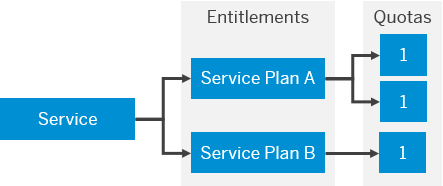

<!-- loio363f0f68f9704830ac65c87a2562559b -->

# Entitlements and Quotas

When you purchase an enterprise account, you’re entitled to use a specific set of resources, such as the amount of memory that can be allocated to your applications.

-   On SAP BTP, all external dependencies such as databases, messaging systems, files systems, and so on, are **services**. In this context, multitenant applications and environments are considered services.

    Each service has one or more **service plans** available. A service plan is the representation of the costs and benefits for a given variant of a particular service. For instance, a database may be configured with various "T-shirt sizes", each of which is a different service plan.

-   An **entitlement** is your right to provision and consume a resource. In other words, entitlements are **the service plans** that you're entitled to use.

-   A **quota** represents the numeric quantity of a service plan that you're entitled to consume in your global account and its subaccounts.

-   Entitlements are either managed at global account or directory level and are distributed from there to subaccounts.

For more information, see [Entitlements and Quotas](https://help.sap.com/viewer/65de2977205c403bbc107264b8eccf4b/Cloud/en-US/00aa2c23479d42568b18882b1ca90d79.html "When you purchase an enterprise account, you’re entitled to use a specific set of resources, such as the amount of memory that can be allocated to your applications.") :arrow_upper_right: and [Managing Entitlements and Quotas Using the Cockpit](https://help.sap.com/viewer/65de2977205c403bbc107264b8eccf4b/Cloud/en-US/c8248745dde24afb91479361de336111.html "When you purchase an enterprise account, you are entitled to use a specific set of resources, such as the amount of memory that can be allocated to your applications.") :arrow_upper_right:.

