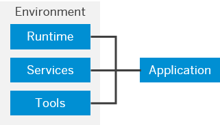

<!-- loio91d37e3e7ea8418d86c15078a352d70d -->

# Environments

Environments constitute the actual platform-as-a-service offering of SAP BTP that allows for the development and administration of business applications. Environments are anchored in SAP BTP on subaccount level. 

Each environment comes equipped with specific tools, technologies, and runtimes that you need to build applications. So a multi-environment subaccount is your single address to host a variety of applications and offer diverse development options. One advantage of using different environments in one subaccount is that you only need to manage users, authorizations, and entitlements once per subaccount, and thus grant more flexibility to your developers.

You can use different environments within the same subaccount: Choose multi-environment subaccounts to use Cloud Foundry, ABAP, and Kyma within the same subaccount. However, inside such a multi-environment subaccount, you cannot use Neo. To use Neo, you create a separate Neo subaccount. Neo cannot be combined with other environments in the same subaccount.

SAP offers the following environments:

-   [Cloud Foundry Environment](https://help.sap.com/viewer/65de2977205c403bbc107264b8eccf4b/Cloud/en-US/9c7092c7b7ae4d49bc8ae35fdd0e0b18.html "The Cloud Foundry environment allows you to create polyglot cloud applications in Cloud Foundry. It contains the SAP BTP, Cloud Foundry runtime service, which is based on the open-source application platform managed by the Cloud Foundry Foundation.") :arrow_upper_right:

    The Cloud Foundry environment enables you to develop new business applications and business services, supporting multiple runtimes, programming languages, libraries, and services. You can leverage a multitude of buildpacks, including community innovations and self-developed buildpacks.

-   [ABAP Environment](https://help.sap.com/viewer/65de2977205c403bbc107264b8eccf4b/Cloud/en-US/11d62652aa2b4600a0fa136de0789648.html "The ABAP environment allows you to create extensions for ABAP-based products, such as SAP S/4HANA Cloud, and develop new cloud applications. You can transform existing ABAP-based custom code or extensions to the cloud.") :arrow_upper_right:

    The ABAP environment allows you to create extensions for ABAP-based products, such as SAP S/4HANA Cloud, and develop new cloud applications. You can transform existing ABAP-based custom code or extensions to the cloud.

    To plan and set up your landscape and lifecycle management in the ABAP environment, see [ABAP Lifecycle Management](https://help.sap.com/viewer/65de2977205c403bbc107264b8eccf4b/Cloud/en-US/5c7b17d68bb7427d93ff2086f01b2a55.html "") :arrow_upper_right:.

-   [Kyma Environment](https://help.sap.com/viewer/65de2977205c403bbc107264b8eccf4b/Cloud/en-US/468c2f3c3ca24c2c8497ef9f83154c44.html "SAP BTP, Kyma runtime provides a fully managed cloud-native Kubernetes application runtime based on the open-source project "Kyma". Based on modular building blocks, Kyma runtime includes all the necessary capabilities to simplify the development and to run enterprise-grade cloud-native applications.") :arrow_upper_right:

    SAP BTP, Kyma runtime provides a fully managed cloud-native Kubernetes application runtime based on the open-source project "Kyma". Based on modular building blocks, Kyma runtime includes all the necessary capabilities to simplify the development and to run enterprise-grade cloud-native applications.

-   [Neo Environment](https://help.sap.com/viewer/65de2977205c403bbc107264b8eccf4b/Cloud/en-US/0f79436cf43a4785bb5b7ee9dac0c76a.html "The Neo environment lets you develop HTML5, Java, and SAP HANA extended application services (SAP HANA XS) applications. You can also use the UI Development Toolkit for HTML5 (SAPUI5) to develop rich user interfaces for modern web-based business applications.") :arrow_upper_right:

    The Neo environment lets you develop HTML5, Java, and SAP HANA extended application services \(SAP HANA XS\) applications. You can also use the UI Development Toolkit for HTML5 \(SAPUI5\) to develop rich user interfaces for modern web-based business applications.

If you consider creating Neo subaccounts, see [Migrating from the Neo Environment to the Multi-Cloud Foundation for SAP BTP (Cloud Foundry and Kyma)](https://help.sap.com/viewer/b017fc4f944e4eb5b31501b3d1b6a1f0/Cloud/en-US/aae4e0ae1cdf434b908c3c8cf3ea942a.html "Learn why and how to migrate scenarios from the Neo environment to the multi-cloud foundation for SAP BTP. This guide is for SAP Business Technology Platform (SAP BTP) customers and partners with scenarios in the Neo environment that need to move to the multi-cloud foundation, including the Cloud Foundry environment or the Kyma environment.") :arrow_upper_right: to learn about the Neo environment and the multi-cloud foundation.

<a name="loio91d37e3e7ea8418d86c15078a352d70d__section_brc_k2l_kpb"/>

## Environment Instances

To actually use an environment in a subaccount, you must **enable** it, which creates an instance of that environment. There are several ways to create **environment instances**:

-   In the SAP BTP cockpit, on the subaccount overview, choose *Enable*.

-   In the SAP BTP cockpit, under *Service Marketplace*. Here, you get more information, such as the available plans and links to further information.

-   Using the BTP CLI command `btp create accounts/environment-instance`

**Related Information**  

[SAP BTP, Serverless Runtime](https://help.sap.com/viewer/product/XF_SERVERLESS_RUNTIME/Cloud/en-US)

[Consuming SAP BTP Services from Various Environments](https://help.sap.com/viewer/09cc82baadc542a688176dce601398de/Cloud/en-US/aa2ba1475dc943498a9d873af074821c.html)

