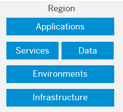

<!-- loioabaaf083a6574edc8ad30d9cd9a062f3 -->

# Regions

You can deploy applications in different **regions**. Each region represents a geographical location \(for example, Europe, US East\) where applications, data, or services are hosted.

Regions are provided either by SAP or by our Infrastructure-as-a-Service \(IaaS\) partners Amazon Web Services \(AWS\), Microsoft Azure, Google Cloud, and Alibaba Cloud. The third-party region providers operate the infrastructure layer of the regions, whereas SAP operates the platform layer and Cloud Foundry. 

A region is chosen at the subaccount level. For each subaccount, you select exactly one region \(that is one data center\).

For more information, see [Regions](https://help.sap.com/viewer/65de2977205c403bbc107264b8eccf4b/Cloud/en-US/350356d1dc314d3199dca15bd2ab9b0e.html "You can deploy applications in different regions. Each region represents a geographical location (for example, Europe, US East) where applications, data, or services are hosted.") :arrow_upper_right:.

<a name="loioabaaf083a6574edc8ad30d9cd9a062f3__section_select_region"/>

## Selecting a Region

When deciding on the location of your Platform as a Service \(PaaS\), consider existing Software as a Service \(SaaS\) and Infrastructure as a Service \(IaaS\) and try to locate it close to those or even in the same data center. You can also optimize application performance \(response time, latency\) by selecting a region that's geographically close to your users. However, the selection of a region also depends on many other factors:

-   Check the availability of specific services in the individual regions.

-   Ensure that you comply with security requirements, such as country- or industry-specific data privacy regulations.

-   Consider the location of other cloud offerings you’re using. You might have to locate your solutions in the same data center.

For a complete overview of the availability of services in the different regions, see [Services](https://discovery-center.cloud.sap/serviceCatalog).

> ### Note:  
> To work with the Kyma environment, you need to specify the region for both your **subaccount** and the **cluster**. Note that there is a number of regions available within each plan. For details, see [Regions for the Kyma Environment](https://help.sap.com/viewer/65de2977205c403bbc107264b8eccf4b/Cloud/en-US/557ec3adc3174ed4914ec9d6d13487cf.html "To work with the Kyma environment, you must specify the region for both your subaccount and the cluster.") :arrow_upper_right:.

