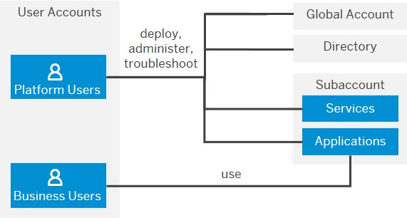

<!-- loioc9c9dd2686354c67939bbc20d541f597 -->

# User and Member Management

On SAP BTP, user management takes place at all levels from global account to environment. There are different types of users, such as depending on their roles in the company.

**User accounts** enable users to log on to SAP BTP, access subaccounts, and to use applications according to the permissions granted to them. We distinguish between two types of users:

-   **Platform users** are usually developers, administrators or operators who deploy, administer, and troubleshoot accounts, applications and services on SAP BTP.

-   **Business users** use the applications that are deployed to SAP BTP. For example, the end users of SaaS apps or services, such as SAP Build Work Zone, or end users of your custom applications are business users.

**Member management** refers to managing permissions for platform users. A member is a user who is assigned to an SAP BTP global account or subaccount. Administrators can add users to global accounts and subaccounts and assign roles to them as needed. You can use predefined roles, for example the administrator role for managing subaccount members.

**User management** refers to managing authentication and authorization for your business users.

For more information, see [User and Member Management](https://help.sap.com/viewer/65de2977205c403bbc107264b8eccf4b/Cloud/en-US/cc1c676b43904066abb2a4838cbd0c37.html "On SAP BTP, user management takes place at all levels from global account to environment. There are different types of users, such as depending on their roles in the company.") :arrow_upper_right:.

