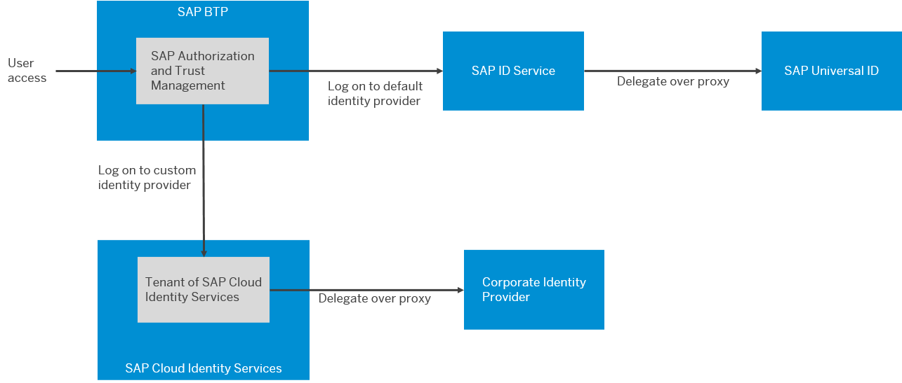

<!-- loio1dbce9caa4314103bbc9a7e3ca548280 -->

# Setting Up Authentication

Your initial access to SAP BTP depends on the default identity provider. After consuming the initial starter scenarios and testing, switch to integrating your own identity and access management solution, where you have control over your own security policies.

We strongly recommend that you always use SAP Cloud Identity Services - Identity Authentication for SAP BTP. If you use corporate identity providers, connect them to your Identity Authentication tenant, which then acts as a proxy. We especially recommend this configuration if you're using multiple corporate identity providers. Avoid trusting your corporate identity provider directly. The use of Identity Authentication is mandatory for platform users or for the use of some applications, such as SAP Build Work Zone and SAP Build Apps for your business users. ABAP-based public cloud solutions require Identity Authentication, too. Identity Authentication is the central integration point for managing identities across all SAP solutions. The support of SAML and OpenID Connect \(OIDC\) eases integration and consumption.

For more information, see [Onboard to SAP Cloud Identity Services](../onboard-to-sap-cloud-identity-services-9c897ee.md).

  
  
**Identity Providers and Federation**

> ### Remember:  
> The two types of users on SAP BTP, platform users and business users, have separate trust configurations for identity providers. Platform users share one or more identity providers configured for the global account and further apply to the directory, subaccount, and the environment levels. Business users use the identity provider configured for each subaccount.

To establish trust for platform and business users, see the following:

-   [Establish Trust and Federation of Custom Identity Providers for Platform Users](https://help.sap.com/docs/btp/sap-business-technology-platform/establish-trust-and-federation-of-custom-identity-providers-for-platform-users?version=Cloud)

-   [Establish Trust and Federation Between UAA and Identity Authentication](https://help.sap.com/docs/BTP/65de2977205c403bbc107264b8eccf4b/161f8f0cfac64c4fa2d973bc5f08a894.html)

> ### Recommendation:  
> For platform users, keep a few backup administrators in the default identity provider or in an additional custom identity provider. Use these backup administrators in case access to your primary custom identity provider fails.

<a name="loio1dbce9caa4314103bbc9a7e3ca548280__section_wfk_fbw_1yb"/>

## Default Identity Providers

SAP ID service is the preconfigured user store you can use in your starter scenarios or for testing. SAP ID service is the place where you register to get initial access to SAP BTP.

SAP Universal ID manages the users of official SAP sites, including the SAP developer and partner community. If you already have such a user, then you're already registered with SAP ID service as well. SAP ID service acts as a proxy for SAP Universal ID, when users log on with their email addresses. Users can log on with and manage all their user accounts with SAP Universal ID.

<a name="loio1dbce9caa4314103bbc9a7e3ca548280__section_kzx_hyw_dyb"/>

## Identity Providers and SAP BTP Environments

The Kyma environment has a separate configuration for the identity provider. We recommend that you also configure your Kyma environment to use Identity Authentication as your custom identity provider.

For more information, see [Configure a Custom Identity Provider for Kyma](https://help.sap.com/docs/BTP/65de2977205c403bbc107264b8eccf4b/67bcc6e2d4d749659faf3ede1853f19e.html).

<a name="loio1dbce9caa4314103bbc9a7e3ca548280__section_llv_ft2_bhc"/>

## Single Sign-On

Use SAP Cloud Identity Services for browser-based Single Sign-On \(SSO\) across all SAP cloud applications, including SAP BTP. For SSO with the SAP GUI \(Graphical User Interface\), use SAP Secure Login Service.

For more information, see [What Is SAP Secure Login Service for SAP GUI?](https://help.sap.com/docs/SAP%20SECURE%20LOGIN%20SERVICE/c35917ca71e941c5a97a11d2c55dcacd/28d654c4459d4693bbf34e5103867f97.html?version=Cloud).

SAP Cloud Identity Services supports both SAML and OIDC protocols for authentication.

### SAML or OIDC

> ### Recommendation:  
> Use OIDC whenever possible.

-   When to Use SAML

    SAML is currently the only supported protocol for setting up multiple trust configurations when SAP Cloud Identity Services acts as a proxy for the same corporate identity provider.

    For more information, see [Configure Different Trust Configurations for the Same Identity Authentication](https://help.sap.com/docs/cloud-identity-services/cloud-identity-services/configure-different-trust-configurations-for-same-identity-authentication?version=Cloud).

-   When to Use OIDC

    -   Applications that require direct authentication with SAP Cloud Identity Services, such as SAP Build Work Zone and SAP Build Apps, must use OIDC.

    -   In principal propagation scenarios, OIDC offers clear advantages, as it uses the lightweight JSON Web Tokens \(JWTs\), instead of the XML-based assertions used in SAML.

    -   The integration with Joule requires a trust configuration of type OIDC with your SAP Cloud Identity Services tenant. SAML-based trust is not supported.

### SSO with Corporate Identity Providers

-   For corporate users, both the first and second authentication factors should be validated by the corporate identity provider \(IdP\), while Identity Authentication delegates the authentication and trusts the result returned by the corporate IdP.

-   When setting up SSO for one application with multiple identity providers, configure conditional authentication. Additionally, to avoid an interim login page, use SP-initiated \(service provider-initiated\) SSO with `idp` parameter.

    For more information, see [Configure Conditional Authentication for an Application](https://help.sap.com/docs/cloud-identity-services/cloud-identity-services/configure-conditional-authentication-for-application?version=Cloud) and [Creating URLs for Applications to Authenticate with Specific Identity Providers](https://help.sap.com/docs/cloud-identity-services/cloud-identity-services/creating-urls-for-applications-to-authenticate-with-specific-identity-providers-44e67223a98f45ed94aaee7513e90a95?version=Cloud).

### SSO with Identity Authentication

Consider passwordless authentication methods, such as FIDO2, certificate-based authentication, or multi-factor authentication \(MFA\). Note that SMS- and RSA-based MFA, require a license for 3rd-party products. Email is not recommended for MFA.

For more information, see [Enable or Disable FIDO2 Biometric Authentication for an Application](https://help.sap.com/docs/cloud-identity-services/cloud-identity-services/enable-or-disable-fido2-biometric-authentication-for-application?version=Cloud) and [Configure X.509 Client Certificates for User Authentication](https://help.sap.com/docs/cloud-identity-services/cloud-identity-services/configure-x-509-client-certificates-for-user-authentication?version=Cloud).

For more information about the second factor for authentication, see [Multi-Factor Authentication](https://help.sap.com/docs/cloud-identity-services/cloud-identity-services/user-guide-multi-factor-authentication?version=Cloud).

If you still need to use passwords, make sure you configure custom password policies according to your corporate security concept.

For more information, see: [Configure Custom Password Policy](https://help.sap.com/docs/cloud-identity-services/cloud-identity-services/configure-custom-password-policy?version=Cloud).

<a name="loio1dbce9caa4314103bbc9a7e3ca548280__section_wnt_lyr_fhc"/>

## Branding and Terms-of-Use

To customize the user experience and meet legal and compliance requirements, configure the following in production tenants as needed:

-   Corporate branding for email templates

    This includes defining templates for *Forgot Password*, *Password Locked*, *Reset Password*, and *Security Alerts*. They play an important role in both security and user experience as users are informed about authentication attempts, password changes, account lockouts, and other activities. Optionally, you can add templates related to account activation, such as *Self-Registration*, *On-Behalf Registration* and *Invitation*, as well as *Email OTP Code*, and *Deactivate TOTP Device*.

    For more information, see [Configuring Email Templates](https://help.sap.com/docs/cloud-identity-services/cloud-identity-services/configuring-e-mail-templates?version=Cloud).

-   Terms-of-use and privacy statements for self-registration and invite scenarios

    For more information, see [Configuring Terms of Use](https://help.sap.com/docs/cloud-identity-services/cloud-identity-services/configuring-terms-of-use?version=Cloud) and [Configuring Privacy Policies](https://help.sap.com/docs/cloud-identity-services/cloud-identity-services/configuring-privacy-policies?version=Cloud).

