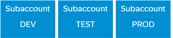
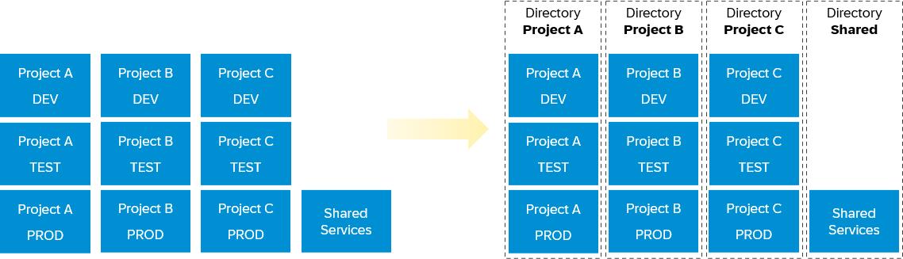
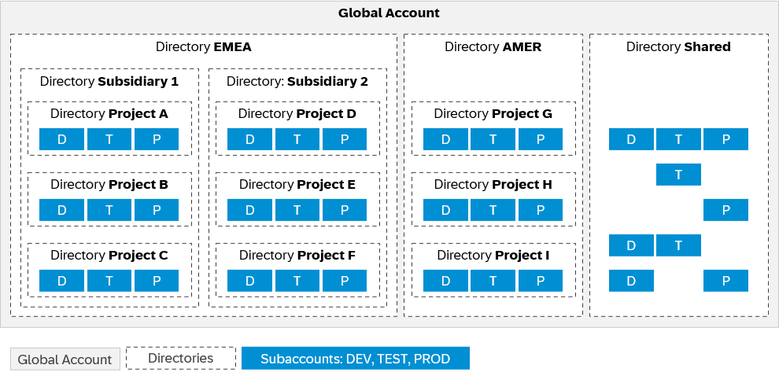

<!-- loio2db81f42f5194454beecde6cd4994dda -->

# Setting Up Your Account Model

Your account model defines how you organize global accounts, directories, and subaccounts in SAP BTP to match your business and development needs.

Start with the basic three-stage model \(development, testing, production\) and extend as needed. SAP BTP provides tools to manage your landscape as it grows.

The hierarchical structure between global accounts, directories, and subaccounts lets you define an account model that accurately fits your business and development needs.

> ### Remember:  
> -   A **global account** is the realization of a contract you or your company has made with SAP.
> -   With **directories**, you can organize and manage your subaccounts according to your technical and business needs. 
> -   In **subaccounts**, you deploy applications, use services, and manage your subscriptions. You can use them to manage members, authorizations, and entitlements.
> 
> Before you set up your account model, you need a global account and administrative permissions. For details, see [Account Model](https://help.sap.com/viewer/65de2977205c403bbc107264b8eccf4b/Cloud/en-US/8ed4a705efa0431b910056c0acdbf377.html#loio8ed4a705efa0431b910056c0acdbf377 "Learn more about the different types of accounts on SAP BTP and how they relate to each other.") :arrow_upper_right:.

Most account models start simple and grow with adoption. The following sections show stages of that evolution, from a single subaccount set to a fully layered directory structure. When you're ready to draft your own, see [Checklist: Drafting Your Account Model](checklist-drafting-your-account-model-7f1c318.md).

<a name="loio2db81f42f5194454beecde6cd4994dda__section_basic_account_model"/>

## Start With the Basics

In the cloud \(just like on premise\), we recommend a **staged development process** to qualify changes before bringing them to production. Typically, this means having one global account and creating one subaccount each for development, testing, and production.

### DEV Subaccount

For development purposes and for testing individual increments in the cloud.

### TEST Subaccount

For integration testing in a production-like environment before release. In highly DevOps-driven companies, the TEST subaccount also serves production workloads. In that case, all testing happens in the DEV subaccount.

### PROD Subaccount

For production applications.

> ### Tip:  
> If you're using Kyma runtime on SAP platform, you might want to combine DEV and TEST in one subaccount. For details, see [Cloud Foundry, Kyma, or Both?](cloud-foundry-kyma-or-both-ec8a269.md).

<a name="loio2db81f42f5194454beecde6cd4994dda__section_typical_account_model"/>

## Grow Per Project

When you onboard a second project or team, a single set of DEV, TEST, and PROD subaccounts might no longer be enough. At this point, create a separate subaccount set for each project and keep things manageable with directories and labels. For details, see [Directories](https://help.sap.com/viewer/65de2977205c403bbc107264b8eccf4b/Cloud/en-US/8ed4a705efa0431b910056c0acdbf377.html#loioa92721fc75524ec09a7a7255997dbd94 "With directories, you can organize and manage your subaccounts according to your technical and business needs.") :arrow_upper_right: and [Labels](https://help.sap.com/viewer/65de2977205c403bbc107264b8eccf4b/Cloud/en-US/8ed4a705efa0431b910056c0acdbf377.html#loioe8663c08ead648faa673b0d63c5b478e "Labels are user-defined words or phrases that you can assign to various entities in SAP BTP to categorize them in your global account, to identify them more easily.") :arrow_upper_right:.

Additionally, you can set up one or more subaccounts for services that are shared between teams or projects, such as SAP HANA Cloud, SAP Integration Suite, or SAP Cloud Logging. For details, see [Sharing SAP BTP Services](sharing-sap-btp-services-9fe7e16.md).

The diagram shows project-specific subaccount sets \(DEV, TEST, and PROD\) and a shared-services subaccount, optionally grouped with directories.

> ### Tip:  
> If you're using Kyma runtime on SAP platform, consider setting up namespaces for each project within your clusters. The idea is the same, but separation happens on namespace level instead of subaccount level. For details, see [Sharing Kyma Clusters](sharing-kyma-clusters-57ec1ea.md).
> 
> For recommendations on using spaces \(Cloud Foundry\) and namespaces \(Kyma\) for structuring, see [Subaccounts or Spaces/Namespaces?](subaccounts-or-spaces-namespaces-4cb5276.md).

<a name="loio2db81f42f5194454beecde6cd4994dda__section_custom_account_model"/>

## Adapt to Your Organization

When your organization spans multiple locations or subsidiaries, you can add more directory layers to reflect that structure.

At this scale, we recommend switching from manual administration to automation, for example, with Terraform \(see [Tools for Account Administration](tools-for-account-administration-6bdb3a7.md#loio6bdb3a7170b84254bfaf0df52a112980)\).

The diagram adds a location layer with top-level directories for each subsidiary, each containing project directories with their own DEV, TEST, and PROD subaccounts.

