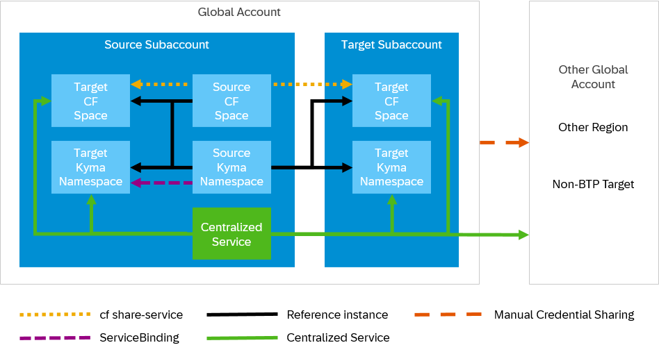

<!-- loio9fe7e160bf58488aa42e726ebe3c7111 -->

# Sharing SAP BTP Services

You can share many SAP BTP services across different scopes, such as spaces, environments, or subaccounts. Sharing services helps you reduce costs, centralize governance, and prevent data fragmentation across duplicate instances.

<a name="loio9fe7e160bf58488aa42e726ebe3c7111__section_scenarios_by_scope"/>

## Sharing Scenarios

To find the right sharing method, identify your scenario. The boundary that you want to cross determines which methods you can use.

> ### Note:  
> -   Some services are designed for central access. You don't need a sharing method; you create one instance and access it from any application through its URL, API, or destinations. For details, see [Centralized Services](sharing-sap-btp-services-9fe7e16.md#loio9fe7e160bf58488aa42e726ebe3c7111__section_centralized_services).
> 
> -   Manual credential sharing is a universal fallback and works in all cases. For clarity, the diagram omits it when other methods are available.

### Different Spaces or Namespaces in One Subaccount

You have a service instance in one Cloud Foundry space or Kyma namespace, and an application in another space or namespace within the same subaccount needs access; like in the following scenarios:

-   Your team migrated microservices to Kyma, but the SAP Authorization and Trust Management service instance still lives in a Cloud Foundry space from before the migration.

-   Multiple applications in different Cloud Foundry spaces must write to the same SAP Cloud Logging instance.

-   A shared Object Store instance in one Kyma namespace serves assets to applications in other namespaces.

Use one of the following methods:

-   Cloud Foundry: Use a reference instance \(SAP Service Manager\) or the `cf share-service` command.

-   Kyma: Use a reference instance \(SAP BTP Operator\) or, within the same cluster, set the field `serviceInstanceNamespace` on the `ServiceBinding`.

-   All runtimes: Use a reference instance or, as fallback, share credentials manually.

### Different Subaccounts in One Global Account

You have a service instance in one subaccount \(often a central governance or shared-services subaccount\), and applications in other subaccounts need access; like in the following scenarios:

-   Central IT manages a SAP Cloud Logging instance in a governance subaccount. Dev teams in their own subaccounts send logs there.

-   A shared SAP Credential Store instance in a security subaccount provides secrets to applications across multiple project subaccounts.

-   You maintain one Object Store for digital assets in a platform subaccount, consumed by product teams in separate subaccounts.

Use one of the following methods:

-   Cloud Foundry: Use the `cf share-service` command with `-o` flag \(if the service supports cross-org sharing\) or share credentials manually.

-   Kyma: Use a reference instance with cross-subaccount access \(SAP BTP Operator and `btpAccessCredentialsSecret`\).

-   All runtimes: Use a reference instance \(for services that support cross-subaccount sharing\) or service-specific sharing methods. If neither is supported, share credentials manually.

### Different Region, Global Account, or Non-SAP BTP Target

Your service instance and the consuming application are separated by a boundary that platform-native sharing can't cross: different regions, different hyperscalers, different global accounts, or the consumer isn't on SAP BTP at all; like in the following scenarios:

-   Your production runs in one region but the disaster recovery environment is in another region. Both environments need access to the same databases and services.

-   After a company acquisition, applications in the acquired company's global account must reach your SAP HANA Cloud database.

-   An on-premise system needs to call a SAP BTP service whose credentials live in a subaccount.

Unless the service provides its own cross-region method, you must share the credentials manually.

<a name="loio9fe7e160bf58488aa42e726ebe3c7111__section_sharing_methods"/>

## Sharing Methods

Each sharing scenario has a producer side \(where credentials originate\) and a consumer side \(where they're used\). These are independent choices. The same source credentials can be consumed differently depending on the target runtime.

### Reference Instances

Reference instances are lightweight pointers to a shared source instance. The platform manages the credential lifecycle: Applications bind to the pointer and receive credentials from the original instance. They don't need access to the source space or namespace. For details, see [Sharing Instances](https://help.sap.com/docs/service-manager/sap-service-manager/instance-sharing). If you prefer working with the CLI, see [btp share services/instance](https://help.sap.com/docs/btp/btp-cli-command-reference/btp-share-services-instance).

Constraints:

-   The service plan must support instance sharing \(see [Services That Support Sharing](sharing-sap-btp-services-9fe7e16.md#loio9fe7e160bf58488aa42e726ebe3c7111__section_which_services_support)\).
-   Cross-subaccount support depends on the runtime and the specific service:
    -   Cloud Foundry: Only available for services that provide their own cross-subaccount reference plan or sharing method.

    -   Kyma: Supported using `btpAccessCredentialsSecret` \(SAP BTP Operator\). For details, see [Working with Multiple Subaccounts](https://help.sap.com/docs/btp/sap-business-technology-platform/working-with-multiple-subaccounts?locale=en-US&version=Cloud).

-   Cross-region or cross-global-account sharing isn't supported.

> ### Tip:  
> If you use both runtimes and place shared services in a central subaccount, Kyma consumers can configure automatic credential rotation using the SAP BTP Operator's `credentialsRotationPolicy` \(opt-in, disabled by default; see [Rotating Service Bindings](https://kyma-project.io/external-content/btp-manager/docs/user/03-40-service-binding-rotation.html)\). Cloud Foundry consumers must rotate credentials manually. Consider this operational trade-off when deciding where to place shared services.

### Service-Specific Methods

Some services implement their own sharing method that differs from the standard reference instance workflow. For details, see [Services That Support Sharing](sharing-sap-btp-services-9fe7e16.md#loio9fe7e160bf58488aa42e726ebe3c7111__section_which_services_support).

Constraints:

-   Not interchangeable with standard reference instances.

-   Scope and limitations are defined by each service individually. Check the service documentation for the exact workflow.

### Cloud Foundry: cf share-service

A Cloud Foundry-native sharing method, separate from SAP Service Manager. This command shares a service instance between spaces within the same Cloud Foundry landscape. You don't need subaccount-level setup. For details, see [Cloud Foundry: Sharing Service Instances](https://docs.cloudfoundry.org/devguide/services/sharing-instances.html).

Constraints:

-   Sharing is scoped to the same Cloud Foundry API endpoint \(same landscape and region\).

-   To set up cross-org sharing \(using the `-o` flag\), you need the `Space Developer` role in both the source and target spaces. The target subaccount must also have an entitlement for the service plan. If the entitlement is missing, the plan doesn't appear in the target org's marketplace and sharing fails.

-   Not all services support cross-org sharing. Check the service documentation before attempting it.

-   Cloud Foundry only \(no Kyma equivalent\).

### Kyma: Cross-Namespace ServiceBinding

The SAP BTP Operator natively supports referencing a `ServiceInstance` in a different namespace within the same cluster. You set `serviceInstanceNamespace` on the `ServiceBinding` to point to the service instance's namespace. This is a binding-level convenience for consuming an instance that exists in another namespace. For details, see [ServiceBinding CR](https://kyma-project.io/external-content/btp-manager/docs/user/resources/02-30-service-binding-cr.html).

Constraints:

-   Same subaccount only \(different namespaces, same cluster\).

-   Kyma only \(no Cloud Foundry equivalent\).

### Manual Credential Sharing

You create a service binding or service key on the source instance and transport the credentials to the target environment outside the platform's credential management. Manual credential sharing works across any boundary, including regions, global accounts, and non-SAP BTP targets, so it’s a universal fallback.

How you inject the credentials depends on the target runtime:

-   Cloud Foundry: User-Provided Service instance. For details, see [Creating User-Provided Service Instances](https://help.sap.com/docs/btp/sap-business-technology-platform/creating-user-provided-service-instances).

-   Kyma: Kubernetes Secret \(mounted as volume or referenced as environment variables\).

-   Non-SAP BTP targets: Any target-appropriate method \(environment variables, vault, configuration file\).

Constraints:

-   You're responsible for managing the entire credential lifecycle: transport, rotation, and cleanup.

-   No platform-level authorization governance: whoever has the credentials has access.

-   The scope of damage from a credential compromise \(blast radius\) grows with the number of targets sharing a single credential set. To limit exposure, create one service key per consuming application.

<a name="loio9fe7e160bf58488aa42e726ebe3c7111__section_which_services_support"/>

## Services That Support Sharing

To check whether a service plan supports instance sharing, go to the SAP BTP cockpit and look for the *Share* option under *Instances and Subscriptions*.

For example, the following services support standard instance sharing:

-   SAP Cloud Logging: Share one instance between different subaccounts, Cloud Foundry spaces, or Kyma clusters. For details, see [Share Service Instances Across Different Spaces](https://help.sap.com/docs/cloud-logging/cloud-logging/ingest-via-cloud-foundry-runtime?locale=en-US&version=Cloud#loiof5a7c993743c4ee79722479371b90b37__share_service_instance_across_different_spaces).

-   SAP Authorization and Trust Management service: Share one instance across spaces or environments within the same subaccount. For details, see [Sharing and Unsharing Service Instances](https://help.sap.com/docs/BTP/65de2977205c403bbc107264b8eccf4b/8915127529b545f8aa71dabcfe7133ec.html?locale=en-US&version=LATEST).

-   SAP Feature Flags service: Share one instance across environments within the same subaccount so that multiple applications evaluate the same flag definitions. For details, see [Share a Service Instance](https://help.sap.com/docs/FEATURE_FLAGS/2250efa12769480299a1acd282b615cf/14a58d926c034b28a0239b872f5d25be.html?locale=en-US&version=LATEST).

-   Object Store service on SAP BTP: For details, see [Instance Sharing](https://help.sap.com/docs/object-store/object-store-service-on-sap-btp/instance-sharing-capability).

Some services support instance sharing but use service-specific methods that differ from the standard reference instance \(or `btp share`\) workflow; for example, the following:

-   SAP HANA Cloud: For details, see [Map an SAP HANA Database to Another Environment Context](https://help.sap.com/docs/hana-cloud/sap-hana-cloud-administration-guide/map-sap-hana-database-to-another-environment-context).

-   PostgreSQL on SAP BTP: For details, see [Instance Sharing](https://help.sap.com/docs/postgresql-hyperscaler-option/postgresql-on-sap-btp-hyperscaler-option/instance-sharing).

-   Redis on SAP BTP: For details, see [Instance Sharing](https://help.sap.com/docs/redis-hyperscaler-option/redis-on-sap-btp-hyperscaler-option/instance-sharing).

-   SAP Credential Store: For details, see [Share, Unshare, and Authorize a Service Instance](https://help.sap.com/docs/credential-store/sap-credential-store/share-unshare-and-authorize-service-instance).

<a name="loio9fe7e160bf58488aa42e726ebe3c7111__section_centralized_services"/>

## Centralized Services

For services that are designed for central access, you don't need a sharing method. For details on central deployment, read the service's setup documentation.

The following are examples of services you typically set up centrally:

-   [SAP Automation Pilot](https://help.sap.com/docs/automation-pilot): Designed as a centralized service. Set up one instance.

-   [SAP Build Work Zone](https://help.sap.com/docs/build-work-zone-standard-edition): You can set it up as a central shared service, optionally with sites for different use cases. Alternatively, use a distributed setup with per-subaccount instances. Either way, use a standard staged setup.

-   [SAP Business Application Studio](https://help.sap.com/docs/bas): For a limited number of apps or developers, set up one instance.

-   [SAP Cloud Transport Management](https://help.sap.com/docs/cloud-transport-management) \(cTMS\): Designed as a centralized service. You may need additional instances for access isolation \(a DEV instance exposes production destinations to all DEV admins\), team separation, or storage capacity limits \(see [Storage in SAP Cloud Transport Management: What To Know](https://help.sap.com/docs/TRANSPORT_MANAGEMENT_SERVICE/7f7160ec0d8546c6b3eab72fb5ad6fd8/e8d5187d1352430aacbe04d4f3b0eb62.html?locale=en-US&version=LATEST)\).

-   [SAP Integration Suite](https://help.sap.com/docs/integration-suite): To develop and change integration flows, set up two or more instances. For details, see [Blueprints for Success: Landscape Setup Recommendations](https://community.sap.com/t5/technology-blog-posts-by-sap/blueprints-for-success-landscape-setup-recommendations-for-sap-integration/ba-p/14223138).

-   [SAP Cloud Identity Services](https://help.sap.com/docs/cloud-identity-services): One test and one productive tenant, reused by all SAP solutions in the landscape. Per-subaccount service instances establish trust but point to the same tenants. For details, see [Tenants](https://help.sap.com/docs/cloud-identity-services/cloud-identity-services/tenant-model-and-licensing?locale=en-US&version=Cloud).

-   [SAP Task Center](https://help.sap.com/docs/task-center): Designed as a unified task inbox for all connected SAP and non-SAP systems. If you use more than one instance, users must check each inbox separately.

-   [Joule](https://help.sap.com/docs/joule): Set up one instance per landscape stage in a dedicated central subaccount. For details, see [Customer-Managed Provisioning](https://help.sap.com/docs/joule/integrating-joule-with-sap/initial-setup?locale=en-US&version=CLOUD).

<a name="loio9fe7e160bf58488aa42e726ebe3c7111__section_do_not_share"/>

## Services You Must Not Share

Don't share services where credentials grant blanket access to security-sensitive operations, or where the service's functionality is architecturally scoped to a single space or subaccount; such as the following examples:

-   [SAP Continuous Integration and Delivery](https://help.sap.com/docs/continuous-integration-and-delivery): All subscription users can use stored credentials in any pipeline job. Sharing the instance across teams means every team's pipelines can reference every credential. For details, see [Credential Handling](https://help.sap.com/docs/continuous-integration-and-delivery/sap-continuous-integration-and-delivery/credential-handling?locale=en-US&version=Cloud).

-   [SAP Content Agent service](https://help.sap.com/docs/content-agent-service): Operates as a local transport agent. Deploy one instance per subaccount in your DEV/QA/PROD landscape. Each instance packages and exports that subaccount's content to SAP Cloud Transport Management.

-   [SAP Mobile Services](https://help.sap.com/docs/mobile-services): Manages app-specific configurations and device registrations tied to a subaccount.

-   [SAP Alert Notification service](https://help.sap.com/docs/alert-notification): Most operational alerts \(app crashes, service failures\) are visible only to an instance in the same Cloud Foundry space as the affected resource. A shared instance in another space can't receive them. For details, see [Built-In Events](https://help.sap.com/docs/alert-notification/sap-alert-notification-for-sap-btp/built-in-events?locale=en-US&version=Cloud).

-   [SAP Job Scheduling service](https://help.sap.com/docs/job-scheduling): The application must be bound to the same Job Scheduling instance to validate the scheduler's callback token \([Concepts](https://help.sap.com/docs/job-scheduling/sap-job-scheduling-service/concepts?locale=en-US&version=Cloud)\). Cross-scope binding breaks authentication.

-   [SAP Build Process Automation](https://help.sap.com/docs/build-process-automation): You can't create more than one service instance per subaccount. Each team needing isolation requires its own subaccount. For details, see [Quotas, Restrictions, and Limits](https://help.sap.com/docs/build-process-automation/sap-build-process-automation/quotas-restrictions-and-limits).

-   [SAP Connectivity service](https://help.sap.com/docs/connectivity): Enforces strict isolation at subaccount level. An application in one subaccount can't access the connectivity resources of another subaccount. You can't configure this; the platform enforces it.

